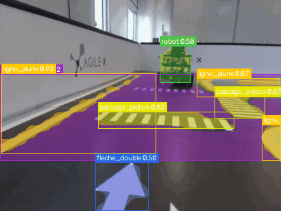
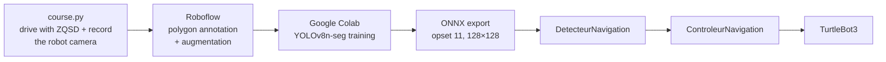
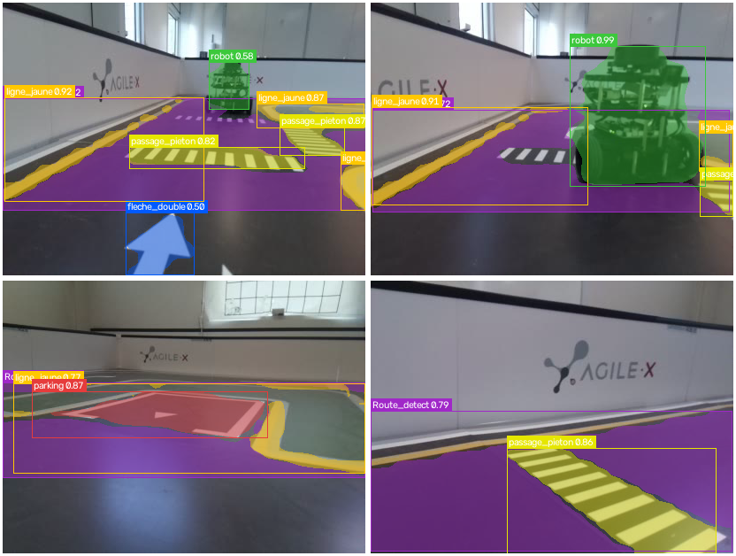
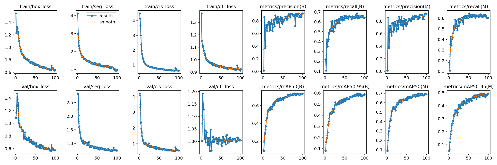
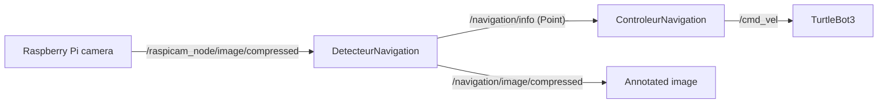

<div align="center">

# 🛣️ TurtleBot3 Road Tracking – YOLOv8 Segmentation & Traffic Rules

**A TurtleBot3 that follows a road on a model city and reacts to pedestrian crossings, arrows, other robots and parking spots, using a YOLOv8-nano segmentation model running in ROS**




<sub>Robot camera while driving in the right direction, segmented by the final model (<code>pr.onnx</code>): road (purple), yellow lines, pedestrian crossings, arrows (blue), another robot (green), parking (red).</sub>

</div>

> [!NOTE]
> 🇫🇷 **This project was carried out in French.** Node names, class names and comments (`route` = road, `pieton` = pedestrian crossing, `fleche` = arrow, `DetecteurNavigation` = navigation detector…) are in French. This README is in English so the project can be read by a wider audience.

---

## 📖 About

Second part of a project for the **Intelligence Artificielle Embarquée** (*Embedded Artificial Intelligence*) course (academic project), 4th year, embedded systems track (January–February 2026), carried out as a **team of two students**.

After [following a tennis ball](../../../turtlebot3-yolov8-ball-tracking), the TurtleBot3 now has to **drive on a model road and respect traffic markings**. Unlike the ball, the road is not a small object: the robot needs to know **where the road is** and **what is painted on it**, so this part uses **instance segmentation** instead of bounding boxes.

## 🔁 Pipeline



### 1. Dataset from the robot's own camera
[`course.py`](suiveur_route/src/scripts/course.py) lets us drive the robot with the keyboard (Z/Q/S/D) while it records its camera stream to a video, with a few extra seconds after the stop request so the end is not cut off. The frames were then annotated on **Roboflow** with **polygons** (instance segmentation) and augmented (brightness, saturation, blur).

### 2. Training (Google Colab, [`training/train.ipynb`](training/train.ipynb))
- **YOLOv8n-seg** (2.9 M parameters, 10.1 GFLOPs), pretrained weights fine-tuned for 100 epochs at **128×128**, with `overlap_mask=True` because markings lie on top of the road.
- Export to **ONNX opset 11**, the version supported by the runtime on the robot.

### 3. Validation on the robot's video ([`training/detect.ipynb`](training/detect.ipynb))

<div align="center">

</div>

<sub>Final model (<code>pr.onnx</code>, 128×128) on frames recorded by the robot: double arrow and crossings with another robot ahead, robot right in front, parking spot, pedestrian crossing.</sub>

## 📊 Results

Validation of the first model (`pro.onnx`, 11 classes, 80 images, 324 objects), box mAP50 per class:

| Road | Road limit | Parking | Arrow | Robot | Pedestrian crossing | Double arrow | Reversed double arrow | Reversed arrow |
|---|---|---|---|---|---|---|---|---|
| **0.92 – 0.99** | **0.97** | **0.89** | **0.84** | **0.83** | **0.78** | 0.57 | 0.39 | 0.15 |

Overall: box mAP50 **0.73**, mask mAP50 **0.69**, inference **2.7 ms / image** (Tesla T4).

<div align="center">

</div>

The large, frequent classes (road, limits, parking, robot) are learned well. The **reversed arrows are weak** because they appear only 4 times in the validation set. This is one of the reasons why the dataset was **re-annotated**: the final robot code uses `pr.onnx`, trained on a cleaner dataset with **8 classes** (road, yellow line, pedestrian crossing, single / double / reversed arrows, robot, parking).

## 🤖 On the robot (ROS)



### Detector: from masks to one decision
For each camera image (resized to 128×128, confidence ≥ 0.5):
1. each mask gives an **area** (pixels) and a **centroid** (image moments); for each class only the largest object is kept;
2. an object triggers an action only when its mask is **large enough**, which means it is close (thresholds out of 16,384 pixels: pedestrian 2000, robot 2000, parking 800, double arrow 500, arrow 350);
3. **one action per image**, chosen by priority: double arrow → pedestrian → robot → parking → arrow → road.

The decision is sent as a `geometry_msgs/Point`: `x` = lateral error between the road centroid and the image centre, `y` = object area, `z` = action code.

### Controller: one behaviour per action

| Code | Situation | Behaviour |
|---|---|---|
| 1 | road | proportional steering on the lateral error, slower in bends |
| 2 | pedestrian crossing | approach, stop, then go straight or turn right |
| 3 | arrow | slow down to take the turn without hitting the wall |
| 4 | another robot | stop as long as it is in front |
| 6 | double arrow | randomly choose *straight* or *right* and keep the choice for the next crossing |
| 0 | nothing detected | rotate in place to find the road again |

A start-up safety keeps the robot still until something has been detected.

## 🚀 Usage

On the TurtleBot3 (ROS Noetic, camera node running), with `ultralytics` installed:

```bash
cd ~/catkin_ws/src
git clone <this-repository-url>
cd ~/catkin_ws && catkin_make && source devel/setup.bash

roslaunch suiveur_route nav.launch    # autonomous road tracking
roslaunch suiveur_route runC.launch   # drive with ZQSD and record a dataset video
roslaunch suiveur_route data.launch   # drive with ZQSD while displaying the segmentation
```

The nodes run from `src/scripts/` (`cwd="node"`), where the models are stored.

## 📁 Repository structure

```
training/
├── train.ipynb                   # YOLOv8n-seg training + ONNX opset 11 export
└── detect.ipynb                  # segmentation test on a robot video
suiveur_route/                     # catkin package
├── src/launch/                   # nav.launch, runC.launch, data.launch
└── src/scripts/
    ├── DetecteurNavigation.py    # camera -> segmentation -> /navigation/info
    ├── ControleurNavigation.py   # /navigation/info -> /cmd_vel
    ├── course.py                 # keyboard driving + video recording
    ├── Datatest.py               # keyboard driving + live segmentation display
    ├── pr.onnx / pr.pt           # final model (8 classes)
    └── pro.onnx / pro.pt         # first model (11 classes)
docs/                             # images used in this README
```

The Git history follows the development: video capture, training, a first architecture that did not work, then a restart from a simple road follower with one behaviour added at a time (pedestrian crossings, arrows, other robot, reversed arrows).

## 🧠 Difficulties & lessons learned

- **The dataset was the hardest part.** We had to rebuild it several times on Roboflow: some annotation choices and project settings were not adapted to segmentation, and it was hard to tell whether a bad behaviour came from the code or from the data.
- **Building incrementally works better**: the first all-in-one version did not work, while restarting from road following alone and adding one rule at a time did.
- Mask **area** is a simple and useful distance estimate, but each class needs its own threshold, tuned on the real robot.
- **Not finished:** parking (detection works, but the manoeuvre could not be calibrated in time) and a "special mode" with blinking LEDs when the robot stops.
- **Next steps:** a larger and more balanced dataset for the rare classes, smoothing decisions over several images, and closed-loop manoeuvres with odometry instead of timed ones.

## 👤 Author

**Sivaharan Kumara Segaram**, embedded systems engineering student. Project carried out with a teammate.
